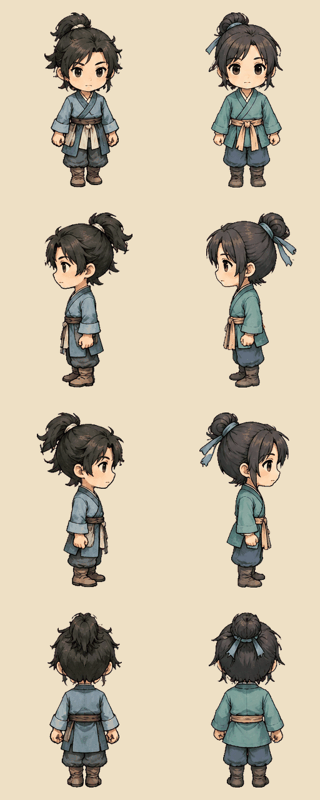

# 主角四向行走

按用户提供的[走路.png 动作参考](images/hero-walk-motion-reference.png)提取四向三帧结构，只参考迈腿与反向摆臂，不使用其像素画风、配色、服装或武器。男女主角继续使用现有身份与手绘淡彩画风。素材按 imagegen 技能流程，经用户指定的 Grsai API、`gpt-image-2.6` 生成。[完整提示词](prompts/hero-walk.txt)

## 素材与帧序

两张源图实际各为 1024 × 1536。分别去背景、校正边缘溢色并统一身高和脚底，保存为 [hero_walk_male.webp](../../app/src/main/res/drawable-nodpi/hero_walk_male.webp)、[hero_walk_female.webp](../../app/src/main/res/drawable-nodpi/hero_walk_female.webp)。每张 768 × 1280，3 列 × 4 行，每格 256 × 320；头顶 y=20、脚底 y=300，人物高度 280 像素，帧间使用一致的中心轴与落脚点。

| 行 | 朝向 | 三列姿势 |
| --- | --- | --- |
| 1 | 南，正面 | 收脚、左脚迈出、右脚迈出 |
| 2 | 西，左侧 | 收脚、左脚迈出、右脚迈出 |
| 3 | 东，右侧 | 收脚、左脚迈出、右脚迈出 |
| 4 | 北，背面 | 收脚、左脚迈出、右脚迈出 |

## 游戏内播放

男女主角在地图上的站姿以民居和小店的门洞为比例参照，脚下的阴影和定位圈随人物等比缩小。验收时在门边比较人物从脚底到头顶与门槛到门楣的高度。

成功移动的一格中，起步和落脚使用收脚帧，中段使用迈步帧；相邻两步交替换脚，组成「收脚→左步→收脚→右步」。位置插值沿用 133 ms，身体只保留很小起伏。人物朝向读取当前状态，南北左右分别选行，左右不再仅靠静态立绘镜像。

松开后当前一步完成即收脚，撞墙不触发新步态；穿门、隐藏地图、切后台和系统关闭动画时停止步态并显示对应朝向的收脚帧。绘制帧属于界面临时状态，不写存档、不推进时间。地图移动规则和存档版本保持原值。

两位主角均齐备四向站立、左右迈步，并在实际地图尺寸核对比例、透明边缘、帧间落脚和遮挡。源图、任务 ID、切图、清单、构建和模拟器证据保存在 `.tmp/hero-walk/`。[验收记录](../task-overview.md#主角四向行走验收)

## 装备外观

探索地图和装备页立像按武器位的物品 ID 绘制轻木棍。棍身沿用背包图标的墨线与暖棕木色。男女主角各用四向三帧的右手握点，朝西时棍在人物后面，其余朝向让握棍的手指遮住棍身。地图上的棍随人物位置、缩放和场景遮挡一起变化。

护具分别绘制布帽、行脚衣、布护腕和软底布鞋。男女图集各用与人物一致的四向三帧顺序。每帧用一个 160 × 327 的单元收纳四个透明图层，按 256 × 320 人物帧的坐标定位。行脚衣、布护腕和软底布鞋沿用走路帧的衣褶和足部轮廓，颜色依据各部位单独制作。布帽按四种朝向贴合头发和发髻。人物先绘制衣服，再绘制护腕，握棍处按相同次序合成。
