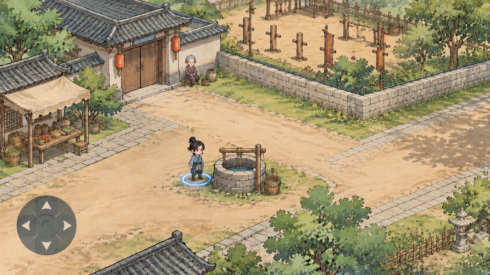
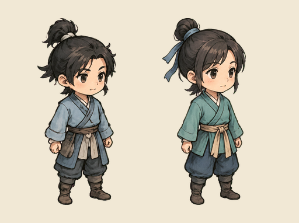
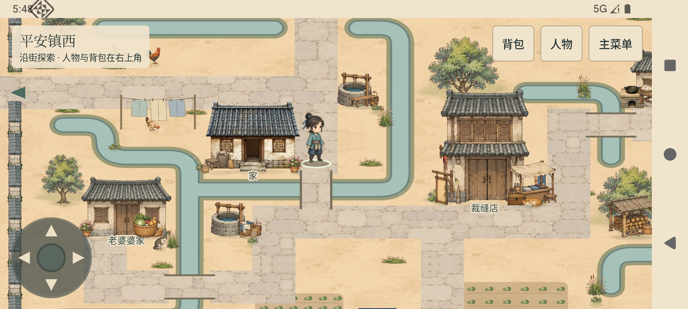
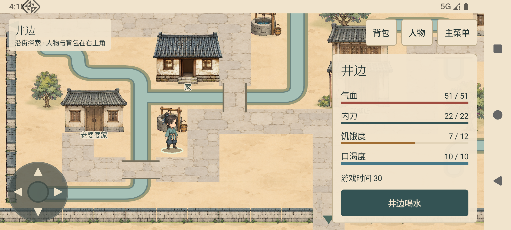
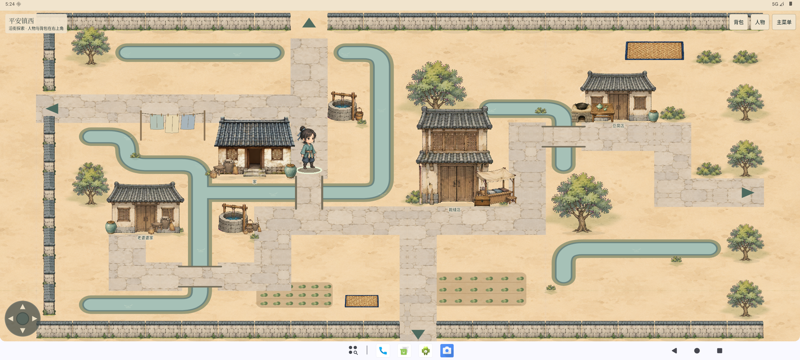
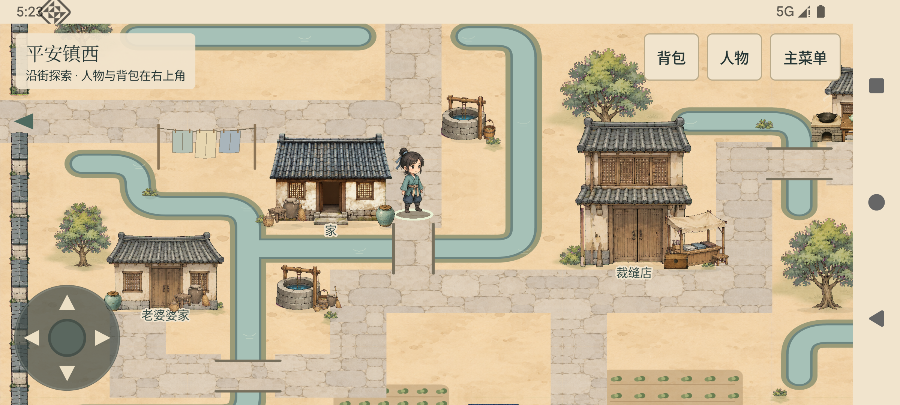
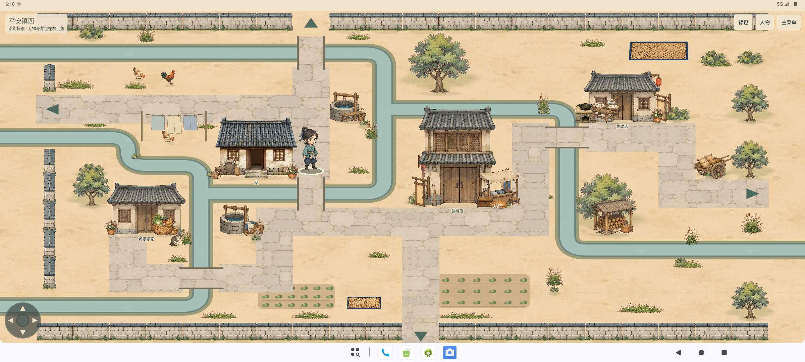
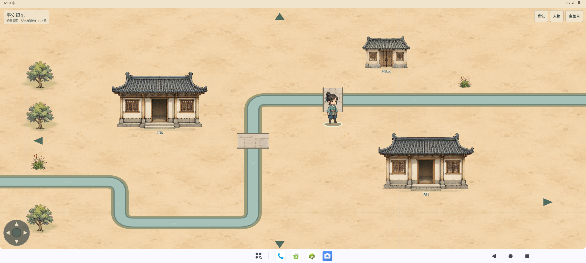

# 小镇井边美术参考

这张图展示白金小镇的地图构图、人物比例和基础探索界面。街景铺满横屏，左下叠加移动摇杆。参考图由 Grsai 的 `gpt-image-2.6` 扩绘，为 1672 × 941 像素的 PNG。

概念图提供材质、人物比例、斜俯视视角和探索界面风格。当前道路、水道、建筑与室内排版以[现有 NC2000 参考图片](../reference/nc2000-west-layout.md)为准，已替换早先 D01 的自定格图。[小镇开局地图](../modules/world/town.md#小镇格图) · [NPC 人物索引](../modules/npcs.md#小镇与周边)

## 共同画法

- **手绘淡彩。** 用细墨线勾出屋檐、井栏、衣服等主要轮廓。低饱和色块表现瓦、木、土和石，保留少量瓦缝、木纹和石块接缝。路面和界面阅读区留出平整色面。
- **市井日常。** 保留青瓦白墙、旧木院门、布棚、竹篮和陶罐。器物放在有人会用的位置，像井边的水桶、院门旁的粮篮、校场里的练功木桩。花木沿墙根和街边成簇，路上留出走动空间。
- **统一光线。** 地图和人物共用柔和的日光与投影方向。屋檐下、井栏内侧和人物脚下有轻重不同的阴影。

| 色彩参考 | 图中取样 | 用途 |
| --- | --- | --- |
| 瓦青 | `#6E7577` | 青瓦与远处屋顶 |
| 土褐 | `#D7BA95` | 主要夯土路面 |
| 灰米 | `#B3A189` | 石墙、井栏与路沿 |
| 暖棕 | `#94735B` | 木门、井架与木桶 |
| 灰绿 | `#768561` | 树叶和墙边草木 |
| 暖白 | `#F1E4CD` | 素纸界面底色 |
| 墨青 | `#445C62` | 当前主要操作的按钮 |

色值用来对照材质和明暗，随场景光照调整。朱红用于界面上的伤势和警示。

## 画地图时保留的元素

用斜俯视画出街巷和院落，让屋顶、墙面与地面同时可读。以小镇格图核对通行格和交互格，再画路面和遮挡。路沿、墙和门洞把能走的路径交代清楚，井、院门和校场各有不同的轮廓。

| 元素 | 保留的画法 | 放进地图时检查 |
| --- | --- | --- |
| 水井 | 低矮的圆形石井栏，配木架、井绳和木桶 | 井边留出能站到的地面，井栏和角色的脚都看得见 |
| 院门 | 青瓦屋檐下的木门和石阶，门边有坐凳、粮篮或陶罐 | 从街上能认出老婆婆所在的房屋入口，到屋内交互格的路连续 |
| 建筑门面 | 民居靠屋顶、门式和生活器物辨认。店铺用布幡、摊案和竖招，公共建筑用门楼、匾额及用途各异的器物 | 在游戏实际比例辨认每栋建筑，检查招牌字位于牌面内、门口没有界面叠加的建筑名，门洞与通行格对齐 |
| 街巷与摊位 | 宽土路接石板路，米色布棚和摊具靠街沿布置 | 岔路、可通行区域和墙体边界清楚，摊棚与树冠给转弯处留出视线 |
| 校场 | 围墙围出开阔练习区，用木桩表明用途 | 从相连的街路上看得到校场入口，入口接到实际可走的路径 |

井边是这张图中最容易辨认的地方。画可探索的地图时，把这套辨识度也用到岔路、入口和交互点上。从小镇起点前往院门、水井或校场，都能沿着画面上的路判断下一步往哪走。[探索区域和出入口](../modules/world.md#多区域探索与支线)

## 生成人物时保留的元素

**已确认的男女主角是全项目人物画风样板。** 新生成或重绘的 NPC 均用这组样板作生图风格参考，按各自人物档案另行绘制。

- **公仔比例。** 站姿以约三头身为基准，头脸圆润，眉眼清楚，手脚和四肢短而简洁。用发式、体态、表情、衣着和随身物辨认不同年龄与身份的人物，身高随人物设定调整。
- **墨线淡彩。** 用清楚的手绘墨线勾轮廓，以低饱和色块和柔和阴影表现衣料及面部，衣褶集中在领口、束带与肘膝等结构处。
- **地图视角。** 全身入画，采用与地图一致的斜俯视和光照。站姿脚底接地，坐姿贴合地面或坐具。需要对话肖像时，沿用同一画风及人物的脸型、发式和衣着。

| 人物或用途 | 保留的元素 |
| --- | --- |
| 开局玩家角色 | 两位主角均保留圆脸和小发髻。男角穿青灰交领布衣，女角穿灰青绿交领布衣，搭配束带和布靴 |
| 老婆婆 | 花白头发、棕色布衣，坐在自家院门边的小凳上。用粮篮和陶罐交代她卖口粮的日常。坐姿与衣色可作为出图参考，常驻位置以人物档案为准 |

**地图验收。** 将 NPC 和主角放到同一张地图，以游戏内正常尺寸核对头身、轮廓、色调和朝向。确认人物身份能从外观辨认，脚底或坐具的位置正确，人物与井栏、门槛和家具的尺度相称。选中角色时，可在脚下叠加细淡的定位记号。[人物索引](../modules/npcs.md#小镇与周边) · [老婆婆档案](../modules/npcs/town-street.md#老婆婆) · [相貌](../modules/character.md#相貌)

## 探索界面参考

- 常态探索以铺满横屏的地图为主。左下摇杆叠在地图上，采用半透明圆盘、四向箭头和中心摇杆。拨住连续走，松手回中。
- 角色到达水井的交互格时，右侧显示井边信息栏，呈现角色读数和「喝水」操作。离开井边后信息栏收起。[井边站位](../modules/world/town.md#地点与交互格)
- 井边信息栏采用暖白素纸、细分隔线和深墨正文。「喝水」用墨青色强调。低饱和状态条按实际角色数值显示。按钮与文字的安全区按两种横屏比例核对。[触控与布局验收](../acceptance.md#真机验证)

## 随包贴图

镇西布局重排复用已有 `town_v2_` 小镇素材、`home_` 室内素材和已确认男女主角；后续小镇氛围增补使用 `town_village_` 素材，见下方记录。小镇素材原由 Grsai `gpt-image-2.6` 生成，原始 PNG、完整提示词、任务 ID 与拆图脚本保存在 `.tmp/town-redraw/`；室内源图在 `.tmp/hero-home/`。[随包贴图](../../app/src/main/res/drawable-nodpi)

当前场景把通行、地形和景物分开配置：土院地上按参考铺石路；水道用连续岸线与灰绿水面绘制，转弯平滑连接；桥面复用石材并连接两岸。房屋和树木按配置占地，绘制按脚底深度排序。阻挡格不再自动生成石墙。墙段仅按原图的北、南、西侧外围边界显式摆放，并在出口留缺口。

全图核对时临时降低模拟器显示密度，截图后恢复原设置：

### 小镇重画清单

| 组别 | 当前实现 | 核对方式 |
| --- | --- | --- |
| 地面与道路 | 现有土院地、连续石板材质 | 只在地形层标出的石路铺石板，院地保留可走空间 |
| 水道与桥 | 连续岸线、灰绿水面、平滑弯角、石桥与桥栏 | 四处桥位连通两岸，水格阻挡；不把波纹水岸解释为石墙 |
| 建筑 | 家、老婆婆家、豆腐店、裁缝店 | 按参考的四处门位出入，对应独立 9 × 9 室内 |
| 室内陈设 | 现有床、缸、凳、木箱、桌、灶和柴堆 | 对照图片排布；床与柜台占地阻挡，桌子暂作柜台外观 |
| 人物 | 原男女主角与棕衣白发老婆婆 | 同图核对公仔比例；老婆婆在屋内 `(4,3)`，玩家站她南侧交互 |
| 探索布局 | 全屏地图、左下摇杆、右上入口、南井信息栏 | 两种横屏比例检查门口、家具与按钮，离井收栏 |

当前布局与旧档迁移检查在 `.tmp/west-layout/`，覆盖规则、存档、Debug 构建、Lint 和 Android 模拟器 16:9／20:9。旧 `.tmp/town-redraw/` 属于素材重画阶段记录，其中旧围墙格局已被本次布局替换。[当前格图](../modules/world/town.md) · [验收记录](../task-overview.md#镇西布局修正验收)

## 镇西的日常细节

保留已确认的镇西排版，在使用地点成组补充生活用品：家门边的扫帚、粮篮和陶缸，屋旁晾衣，裁缝店门前的布摊与木箱，豆腐店的桌面和炉灶，南边空地的晒粮席与小菜畦。器物沿既有建筑角落和路边摆放，井边、桥头及门口的站位保持可读。

继续复用 `town_v2_courtyard`、`town_v2_mending`、家用缸桌炉灶和草木。晾衣、菜畦、粮粒、水纹与炊烟由 Canvas 使用同一组淡彩和细线绘制；没有新增图片生成。晾衣绳轻摆、水面微闪、灶上热气缓慢上升，系统关闭动画时停止这些动态。环境动画只在室外地图可见时运行，不推进游戏时间，不触发存档。

本轮只增加景物，通行层、水道、桥位、入口和服务站位保持原配置，存档继续使用 v5／内容版本 2。构建、测试和模拟器证据留存在 `.tmp/town-life/`。[验收记录](../task-overview.md#镇西生活细节验收)

## 店铺、街边与家畜

在门前用品的基础上，按用途继续组成街边空间：裁缝店挂竖招和布幡，店旁留出布案与猫休息的角落；豆腐店摆白玉豆腐案和灶台，檐下挂灯笼；街沿停运货手推车，树下放柴棚，井边有坐凳、洗衣篮和木桶。花盆置于门侧，河岸与墙根疏密搭配芦苇和野草，仍看得清水道、桥头与街路。

院边公鸡、母鸡有小幅啄食与挪动，猫在店边歇息、理毛并轻微起伏。动物属于场景表现，不增加角色规则或阻挡；沿用室外可见时运行、系统关闭动画时静止的环境动画生命周期。通行层、道路、水道、桥梁、门位、服务站位和存档版本均保留原配置。

新增 16 张 `town_village_` 透明 WebP，由 Grsai `gpt-image-2.6` 按现有地图画风生成，覆盖门面、家用器物、街边货具、河岸草木、鸡和猫。提示词、实际尺寸、素材清单和成组检查见[素材记录](town-village-assets.md)。原版人物另按[地图站位表](../reference/nc2000-west-layout.md#原图人物站位)核对。[本轮验收](../task-overview.md#镇西小镇氛围复验)

## 河道连通与桥下过水

河道按完整水路绘制，补齐北街桥下、树旁及镇西至镇东的缺段。河口越过画面边缘，外围墙在进出水口断开；树、柴棚与芦苇退到岸边，保持水面可读。北街 `(7,1)` 的石路明确画为南北桥，河水从桥下横穿。两端不再画成镇内圆头盲管。

本轮继续复用已有材质与草木，不生成新图片。渲染路径缓存仍由完整地形层生成，边缘河格向画面外延伸；改图保持原有通行格，因此存档版本与位置沿用。河网连通性、边缘对齐及两种横屏的桥面通行检查见[修正记录](../task-overview.md#小镇河道连通修正)。

## 镇东街巷与镇西桥头

镇东用已有石板材质铺主街和支路，圆收路口边缘。药摊用 `town_v2_medicine`，棚架与衙门围墙放在原阻挡格。衙门北墙、侧墙及柱头沿用现有石墙套件，墙身与通行边界对齐。镇西家门外的南北桥加长石板桥面，以木栏和栏柱区分桥头。南井沿用井栏和桶架，井旁木牌与取水格石板提供辨识。

## 生成素材时使用

把概念图里的构图、景物比例、路面材质、视角和光线写进文字提示词，搭配地图格图或人物档案。可用下面的共用描述起笔，再加指定的对象、位置或姿态。

> 原创市井武侠的细墨线和手绘淡彩。瓦青、土褐、灰绿、暖白，柔和日光。用青瓦、旧木、青灰石和布衣表现朴素的小镇日常，轮廓清晰。

- **地图。** 生成「地点」的斜俯视地图底图。按给定格图画出主路、转角、围墙、出入口和交互位置，用实物轮廓区分「地标」。底图供角色和界面叠加。
- **人物。** 用[男女主角样板](images/baijin-opening-travelers.png)作风格参考，生成「人物称呼」的全身地图贴图。按档案写明年龄、身份、衣着、发式与姿态，沿用[统一人物画风](#生成人物时保留的元素)并按游戏内尺寸验收。

### 成组素材验收

《英雄坛说》灰度图 004 和 002 用于核对素材类别、拆件方式和原图用法。地图的画风、镜头和景物比例以本页的白金探索参考图为准。人物画风以[男女主角样板](#生成人物时保留的元素)为准。

**生成前先定齐套条件。** 按组登记用途、使用场景、必备变体、验收样板和缺件。将必备变体写进生图要求。同一物件兼有场景摆放和背包用途时，分别登记场景贴图和物品图标。

| 素材组 | 必备变体 | 验收样板 |
| --- | --- | --- |
| 石墙 | 横段、竖段、转角、端头、门洞 | 拼出带入口的院落，检查墙段衔接和门洞与通行格的对齐 |
| 水岸 | 直岸、凹角、凸角、桥头 | 试拼一段河湾和一个闭合池塘，检查转角接缝及桥头与岸边道路的衔接 |
| 可进入的建筑 | 室外外观、门口贴图、独立室内布局所需的地面、墙面和家具 | 搭出室外门口和独立室内场景，核对门槛、室内落点与出门回程格。[建筑与场景](../modules/world.md#建筑与场景) |
| 开局人物 | 男、女各一张透明背景的卡通公仔全身站姿，包含同高比例和脚底锚点 | 在建角预览、床边和街上核对头身、眉眼和落脚位置 |
| 兼作场景物件和背包物品的井桶 | 场景贴图、物品图标 | 将场景贴图摆在井边，再用背包实际显示尺寸核对图标辨识度 |

**生成后按样板验收。** 核对必备件，登记并补齐缺片。拼接或摆放通过后，这组素材才算齐套，可以接入地图或背包。

[开场主角家的齐套清单及游戏内画面](player-home.md)
