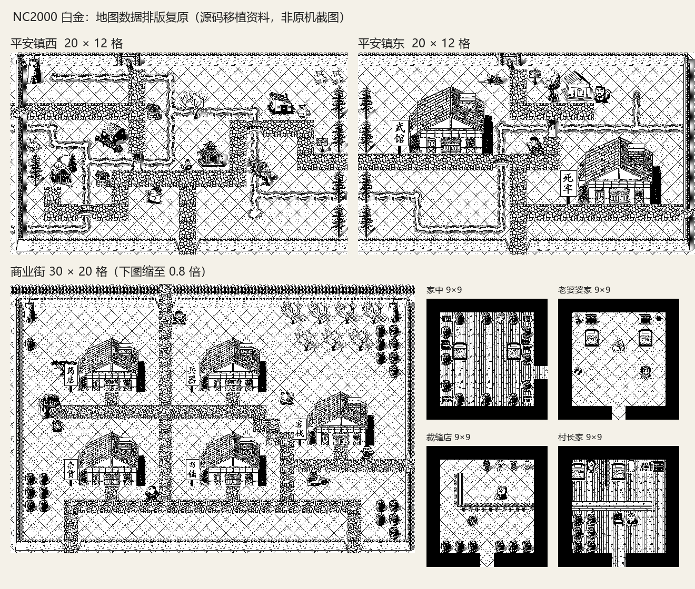

# NC2000 镇西布局参考

本次依据工作区已有黑白地图图片分析排版，未打开网页，也未重新运行原机 ROM。图片来自 GMUD_GB 固定版本 `672f687bbc57b281ab3fbe597b4e041eb2505c6e` 的地图与图块数据复原，属于源码移植资料，不能称为已验证的原机截图。

## 本次采用

- 镇西 20 × 12 的道路、水道、三个桥位、四栋房屋、两口井及入口方向。
- 家中、老婆婆家、豆腐店、裁缝店四个 9 × 9 室内的边界、家具分布与门位。
- 镇东作为既有服务 ID 的连接场景，保留武馆、衙门与村长家对应室内。商业街尚未接入。

黑白波纹边线按水道处理，跨水石路按桥处理，外围墙按原图边界摆放；阻挡格不能统一画成石墙。建筑、人物、树木及家具使用现有手绘淡彩素材。现有桌子用于柜台，树种和器物花纹不作原版图块复刻。未接入的人物与商业街业务留到对应任务实施。

原始参考 PNG、地图单元与比对脚本保存在本机 `.tmp/original-map-review/`，本轮配置、测试日志及模拟器截图在 `.tmp/west-layout/`。[当前格图和门位](../modules/world/town.md) · [美术说明](../art/town-well.md#小镇重画清单)

## 原图人物站位

按工作区已有地图图片及同一固定版本地图记录、`textbank_b0.c` 人物名表核对。地图中可交互对象的编号也包括井、树、床等设施，不将其一律当成镇民。NPC 名称通过人物名表索引核实，不能仅凭黑白小人猜身份。

| 原图场景 | 人物 | 对象格 x,y | 地图人物编号 |
| --- | --- | --- | ---: |
| 平安镇西 | 道德和尚 | 8,8 | 12 |
| 老婆婆家 | 老婆婆 | 4,3 | 25 |
| 老婆婆家 | 小顽童 | 6,5 | 2 |
| 豆腐店 | 潘小莲 | 4,3 | 1 |
| 裁缝店 | 小裁缝 | 3,5 | 29 |
| 裁缝店 | 老裁缝 | 5,3 | 30 |

人物后续按原图身份、场景与站位接入现有手绘画风。本轮街景与动物增补保留该依据，当前已有的老婆婆仍在原图屋内对象格；未将其他原版人物随意移到街上或新增人物专名。原始核对脚本在 `.tmp/town-village/npc-review.py`、`npc-names.py`。

## 河道连续性修正

用户在街景复现后确认，小河应连贯畅通。当前版沿原布局补齐道路下和树旁的缺段，明确北街桥下过水，并将镇西 `(19,8)` 与镇东 `(0,8)` 的河口接齐；外侧河口延伸出画面，树木与柴棚退到岸侧。这是当前游戏地图的连续性修正，原图仍保留作为人物和建筑站位的参考。[当前河道](../modules/world/town.md#河道连续性)
